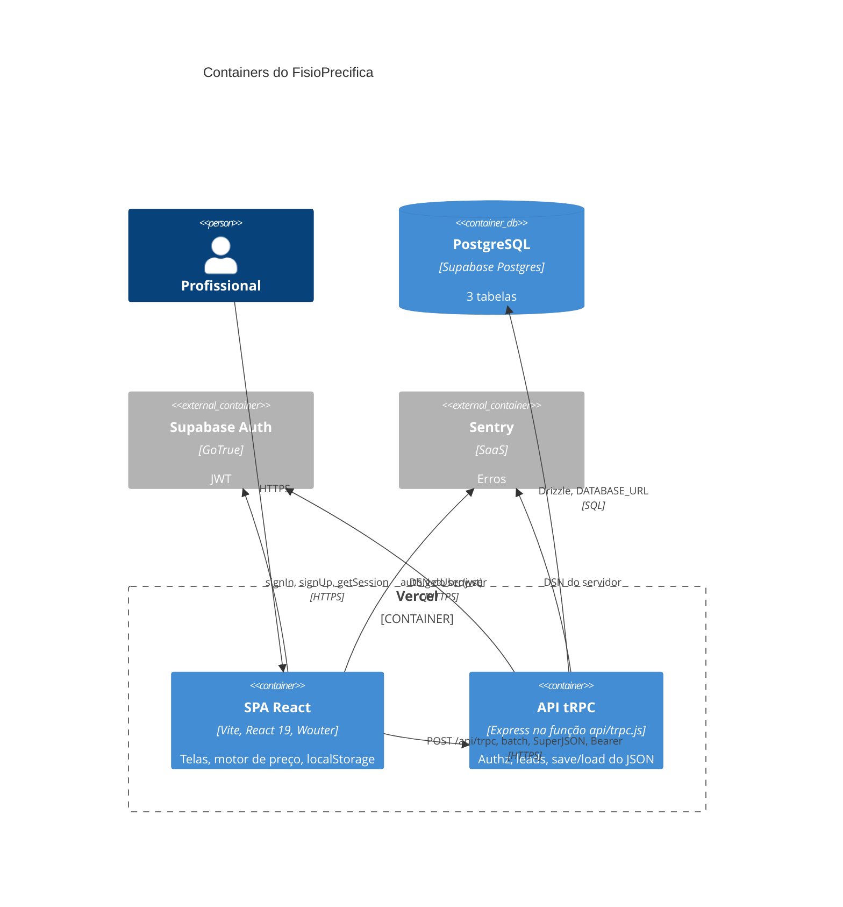

# C4 — Containers

No desenvolvimento, SPA e API nascem do mesmo processo (`server/_core/index.ts` + Vite). Em produção, a Vercel separa o estático e a função. O contrato HTTP é o mesmo path `/api/trpc`. 🟢

Não há container de worker, Redis nem fila. 🟢
