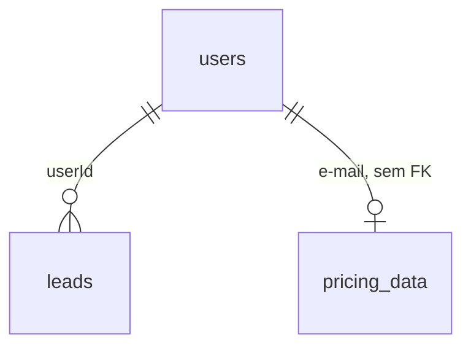

# ERD do banco

O desenho normativo com o JSON expandido está em `../erd-complete.md`. Este arquivo existe porque o Data Master entrega `database/erd.md`.

Três tabelas, um enum `role`. Sem tabela de junção. Sem polimorfismo. 🟢
