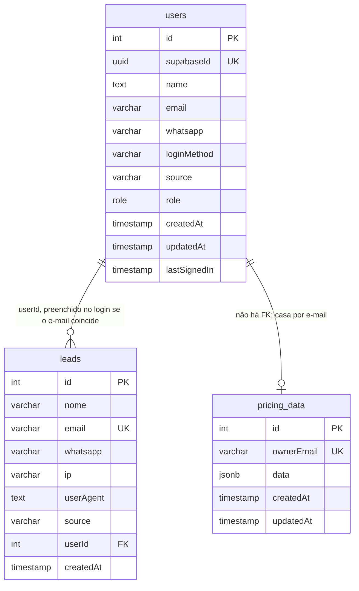
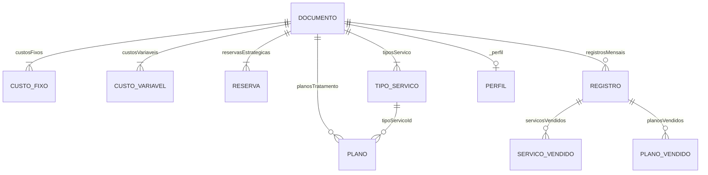

# ERD completo

Tabelas físicas são três. O documento de preço é um agregado dentro de `jsonb`. Cardinalidades do JSON são da aplicação, não do Postgres. 🟢

## Forma de `pricing_data.data`

🟢 tipo `DadosPrecificacao` mais a chave `_perfil`, gravada pelo client e não declarada no tipo. O Zod a descreve.

Não há integridade referencial: um plano pode apontar para `tipoServicoId` inexistente. A UI de serviços procura o serviço e, se não achar, usa o preço base. 🟢 `Servicos.tsx` por volta da linha 298 (`servico ? calcularPrecoServico : precoBase`).

Detalhe coluna a coluna: `database/data-dictionary.md`.
