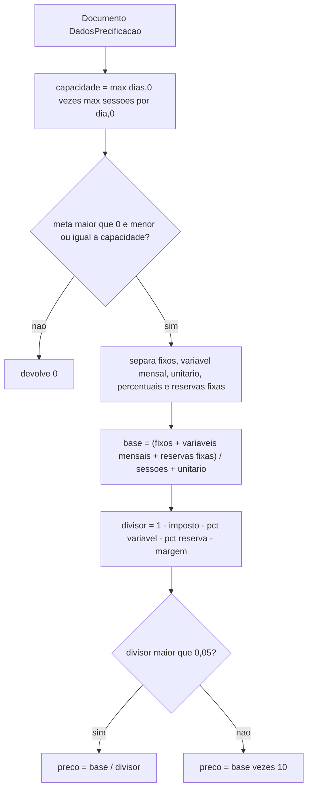

# Fluxo do preço estratégico

O piso usa a mesma proteção, com base sem reservas fixas e denominador sem reserva e sem margem. O sustentável é o estratégico com margem 0. 🟢 `calculations.ts`.

Números de referência travados por teste:

- Fixo mensal 1000, 10 sessões, imposto 0,10, reserva percentual 0,10, margem 0,20, sem variável → estratégico = 100 / 0,60.
- Margem 0,50 e imposto 0,50 → denominador estoura o limiar → preço = custo por sessão × 10, no cenário do teste em que o custo por sessão equivale à base.
