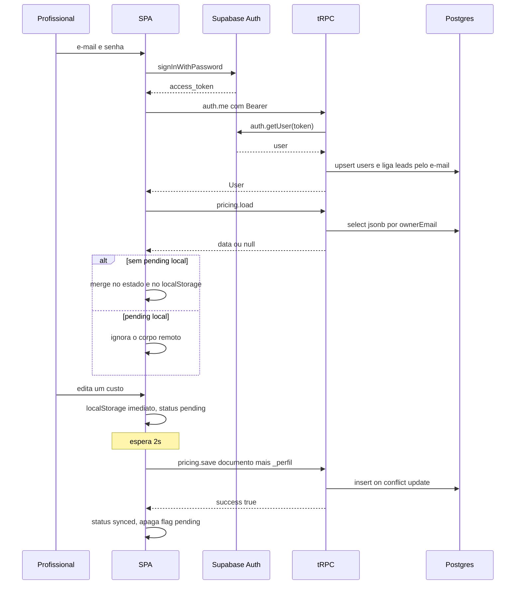

# Sequência — login e sync

Falha de save: status `failed`, flag permanece, novo tentativa em 5s. 🟢

Logout com status não sincronizado pede `confirm` e, se a pessoa aceita sair, não chama `clearAllLocalData`. 🟢
