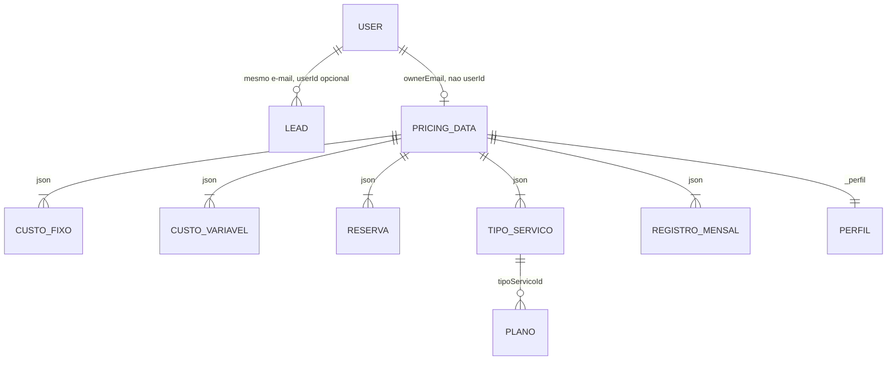

# Alma do Sistema

> Síntese executiva gerada no papel do reversa-extract-soul em 2026-11-12.
> Base: leitura do README, `package.json`, schema Drizzle, `calculations.ts`, rotas e histórico git. Conteúdo em pt-BR; o nome do arquivo permanece `soul.md`.

## 1. Propósito

O FisioPrecifica calcula, para um fisioterapeuta que atende sozinho ou com uma clínica pequena, quanto cobrar por sessão para cobrir custos obrigatórios, reservas e uma margem sobre a receita. 🟢 O público é o profissional de saúde, não um backoffice de rede de clínicas: a landing fala em "sua calculadora de preços" e o design system descreve "um app financeiro para um profissional sozinho". 🟢 A dor que o código resolve é a de precificar no achismo: o motor transforma custos, agenda e alíquota efetiva em três preços (piso operacional, sustentável e estratégico) e deixa o profissional gravar o preço que vai praticar. 🟢

O produto também captura lead na landing e, para quem tem papel `admin`, reúne contatos. 🟢 Isso é aquisição, não o núcleo do preço.

## 2. Entidades centrais

Uma entidade é central quando aparece em mais de um módulo ou é o sujeito do fluxo principal.

| Entidade | O que representa | Relações | Confiança |
|----------|------------------|----------|-----------|
| DadosPrecificacao | Documento de trabalho do profissional: custos, agenda, imposto, serviços, planos e registros | 1 por e-mail dono, persistido em `pricing_data.data` | 🟢 |
| CustoFixo | Gasto que não varia com a sessão, ou depreciação | N dentro do documento; flag `isDepreciacao` | 🟢 |
| CustoVariavel | Gasto mensal, por sessão ou percentual da receita | N dentro do documento | 🟢 |
| ReservaEstrategica | Provisão fixa ou percentual da receita bruta | N dentro do documento | 🟢 |
| TipoServico | Modalidade com multiplicador e custo extra sobre o preço estratégico | N; referenciado por planos e por registros completos | 🟢 |
| PlanoTratamento | Pacote de sessões com desconto | N:1 com TipoServico via `tipoServicoId` (sem FK no banco) | 🟢 |
| RegistroMensal | Fechamento do mês, simples ou completo | N no documento | 🟢 |
| User | Conta espelhada do Supabase Auth | 1:N leads por e-mail; 1 pricing_data por e-mail (não por id) | 🟢 |
| Lead | Contato capturado no banner, com consentimento | N:1 opcional com User | 🟢 |
| PerfilProfissional | Cartão da clínica (`_perfil` dentro do JSON) | 1 por documento de preço | 🟢 |

## 3. Decisões fundadoras

### D1. O preço é uma função pura no cliente

- **Decisão:** calcular no browser, em `client/src/lib/calculations.ts`, sem round-trip para cada número.
- **Evidência:** o arquivo não importa React, tRPC nem Supabase. O servidor só grava o JSON (`server/routers.ts`, `pricing.save` / `pricing.load`).
- **Implicação:** o pacote `pricing-engine` pode nascer desse módulo. O servidor não é fonte da verdade da fórmula. Dois clientes com o mesmo JSON e versões diferentes do bundle podem divergir até o próximo deploy.
- **Confiança:** 🟢

### D2. Um documento JSON por profissional, não um modelo relacional de custos

- **Decisão:** `pricing_data.data` é `jsonb` com o estado inteiro da calculadora.
- **Evidência:** `drizzle/schema.ts` linhas 43–49; o Zod de `pricing.save` espelha o tipo e ainda aceita `.passthrough()`.
- **Implicação:** migrar campo é migração de aplicação (`store.ts`), não de SQL. Consultar "quem tem aluguel acima de X" exige varrer JSON. O CRM futuro não deve normalizar isso dentro do motor; se normalizar, normaliza no host.
- **Confiança:** 🟢

### D3. Identidade é Supabase Auth; autorização de admin é um e-mail de ambiente

- **Decisão:** JWT Bearer validado com `supabase.auth.getUser`; papel `admin` quando o e-mail bate com `ADMIN_EMAIL`.
- **Evidência:** `server/_core/context.ts` linhas 19–36; commit `2b724b6` substitui OAuth da plataforma Manus.
- **Implicação:** não há convite, nem lista de admins, nem revogação automática se `ADMIN_EMAIL` mudar (o upsert só envia `role` quando a pessoa é admin). 🟡
- **Confiança:** 🟢 na regra atual; 🟡 no efeito de trocar o e-mail de admin.

### D4. Margem é percentual da receita, não markup sobre o custo

- **Decisão:** `margemLucro`, imposto, variável percentual e reserva percentual entram no denominador `1 - percentuais`.
- **Evidência:** `dividirComProtecao` em `calculations.ts` linhas 72–75 e 117–123. `store.ts` linhas 272–278 converte `margemLucro > 0.50` de markup antigo para margem.
- **Implicação:** copiar a fórmula antiga `custo / (1 - margem)` da landing, ou um markup `custo * (1 + margem)`, quebra o piso. A landing pública ainda usa a fórmula simplificada. 🟢
- **Confiança:** 🟢

### D5. O app é um monolito SPA + uma função tRPC, deployado na Vercel

- **Decisão:** React/Vite no browser, Express/tRPC no mesmo repositório, Postgres via Drizzle, rewrite da Vercel para `api/trpc.js`.
- **Evidência:** `vercel.json`, `server/vercel-entry.ts`, `package.json` scripts `build`.
- **Implicação:** rate limit em memória e cache de conexão Postgres não sobrevivem a várias instâncias serverless. 🟢 o código; 🟡 o impacto em produção, porque não há métrica no repositório.
- **Confiança:** 🟢

### D6. Catálogo inicial é de fisioterapia, a fórmula não é

- **Decisão:** defaults citam CREFITO, Pilates, gel e eletrodos; a matemática fala em sessão, duração e receita.
- **Evidência:** `client/src/lib/store.ts` linhas 33–85 versus `calculations.ts`, que não menciona profissão.
- **Implicação:** o perfil `fisioterapia` é o catálogo e os rótulos. Fonoaudiologia e terapia ocupacional reaproveitam a fórmula e trocam o catálogo. Venda de aparelho não cabe nessa fórmula. 🟢 a separação; 🟡 que os outros perfis não precisem de outro denominador.
- **Confiança:** 🟢 / 🟡

## 4. Lacunas

- 🔴 O remix de CRM (pacientes, agenda, faturamento) não existe neste repositório. Não dá para citar o contrato de integração além do que este app já expõe: documento de preço + JWT.
- 🔴 Não há `schemaVersion` dentro do JSON. Um pacote compartilhado entre três profissões vai precisar de uma, e o código atual não escolhe o número.
- 🔴 A migração `drizzle/0001_align_supabase_users.sql` declara que não foi executada. O estado real do Postgres de produção não está no git.

## 5. Como ler esse documento

Este `soul.md` é uma síntese. Não substitui:

- `inventory.md` para a superfície
- `code-analysis.md` para o detalhe por módulo
- `domain.md` para cada fórmula
- `architecture.md` para C4 e dívidas
- `extracao-pricing-engine/` para o corte do pacote
