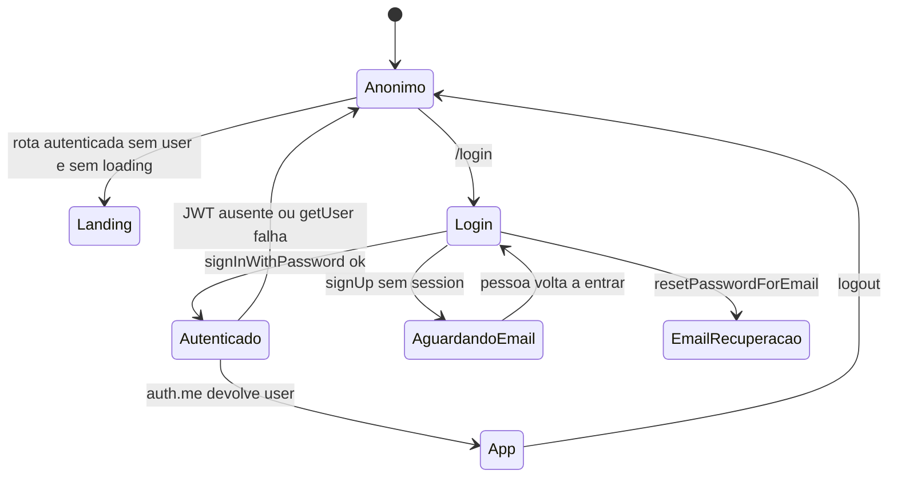
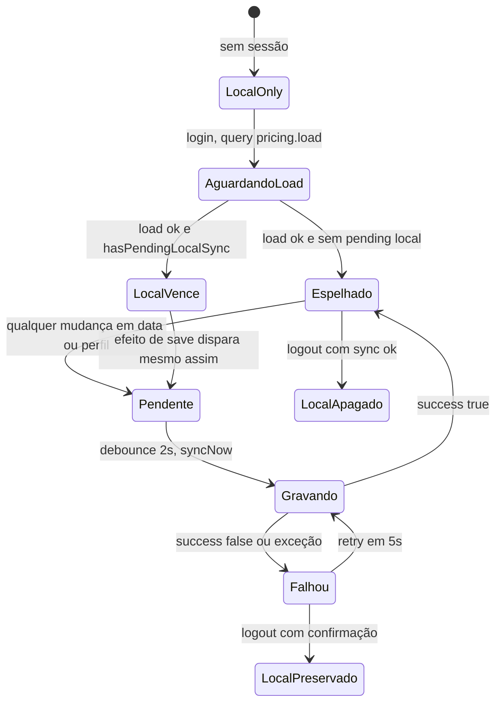
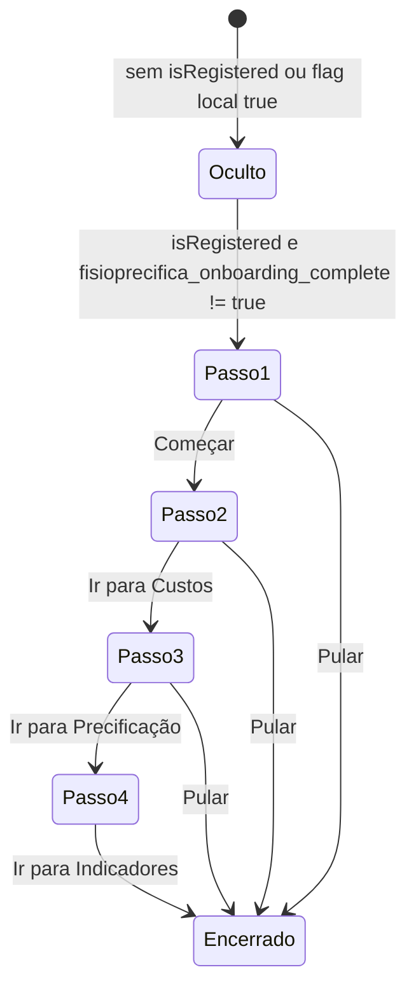
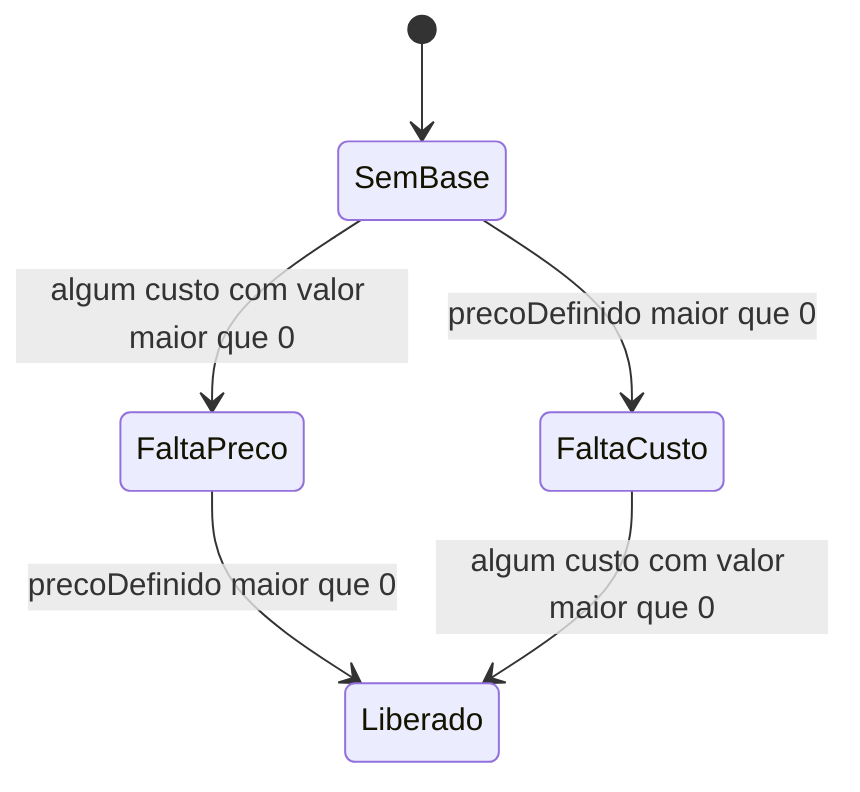
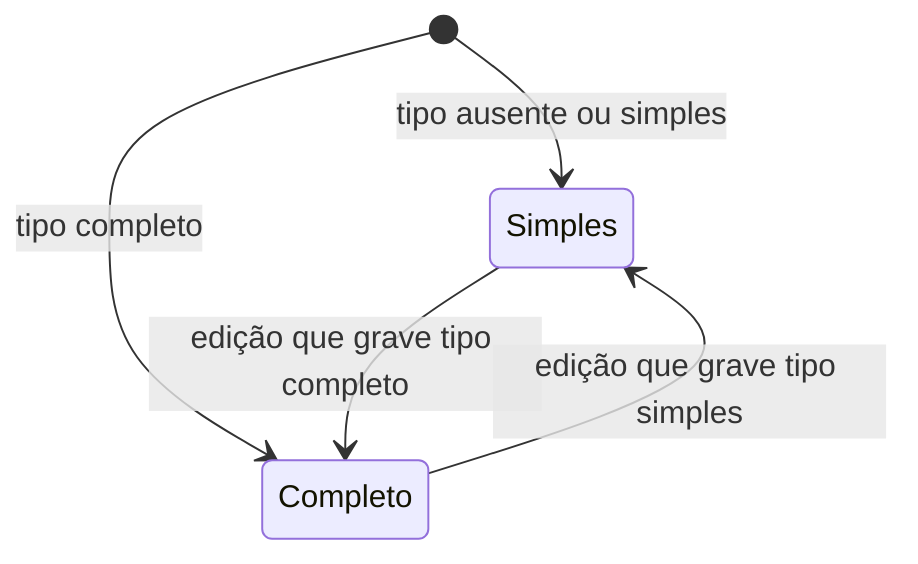
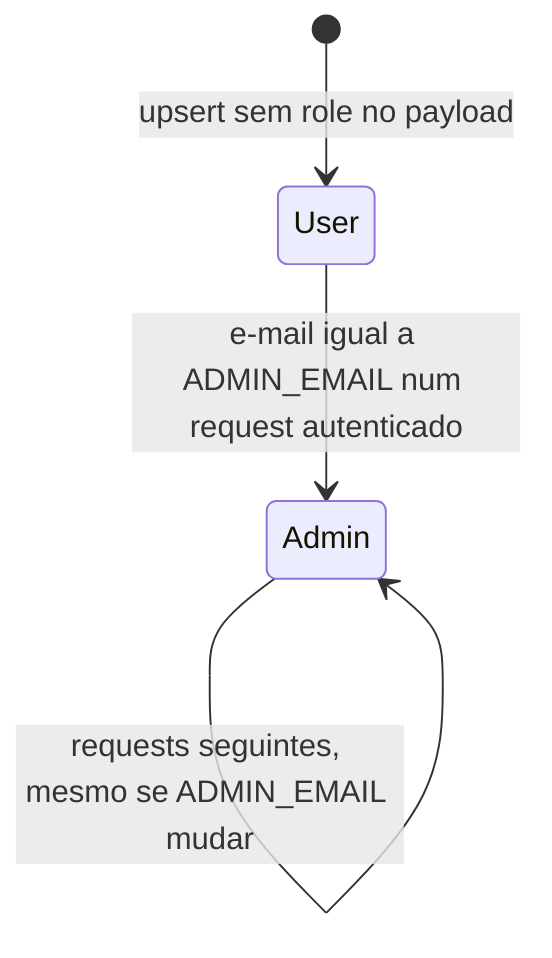
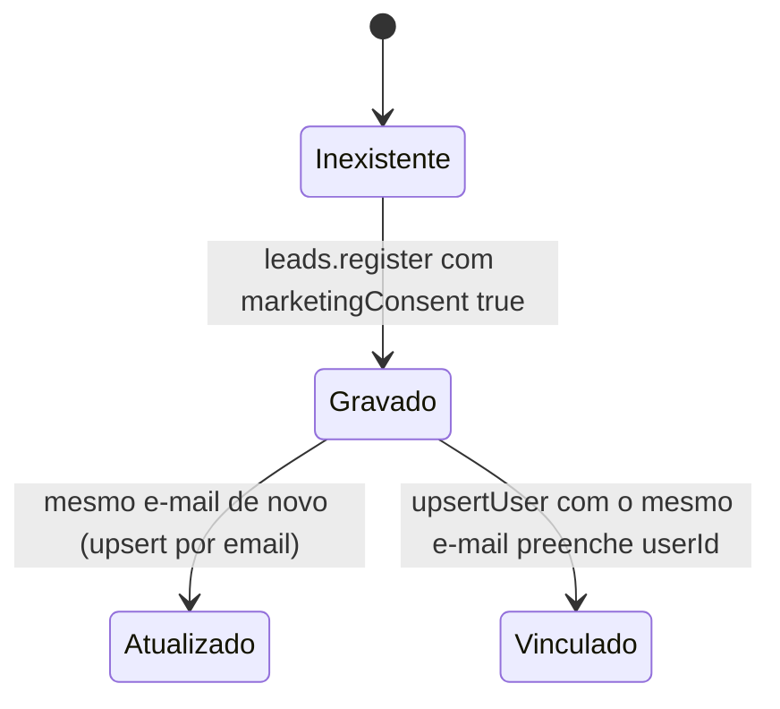

# Máquinas de estado

> Detective. Diagramas do comportamento observável no código, não de um motor de workflow formal. Não há coluna `status` no Postgres. 🟢

## 1. Sessão de autenticação

Rotas públicas mesmo com a sessão desligada no sentido de "não exige user para renderizar a página": `/login`, `/privacidade`, `/termos`. Qualquer outra rota, se `loading` acabou e não há `user`, renderiza `Landing` no lugar do miolo. 🟢 `App.tsx` linhas 33–40.

`isRegistered` no `DataContext` é `user` **ou** lead local antigo. O LeadGate, porém, some apenas com `user`. Um lead local sem sessão ainda vê o banner e, ao mesmo tempo, o onboarding pode abrir. 🟢 os dois critérios diferentes. 🟡 se algum browser ainda tem lead legado sem conta.

## 2. Sincronização do documento

Detalhe 🟢 em `DataContext.tsx` e `sync.ts`:

- Estado inicial da UI: `failed` se `localStorage['fisio_precifica_sync_pending'] == '1'`, senão `synced`.
- Enquanto `remoteDataLoaded` é falso, `syncNow` retorna false e o efeito não agenda POST.
- Load remoto é ignorado quando há pending. O local sujo não é esmagado pela cópia velha do servidor.
- Troca de e-mail (conta diferente na mesma aba) zera o pending, chama `resetData()` e refaz o fetch. Logout para `user` null **não** entra nesse reset: o efeito retorna cedo se não há e-mail.
- Logout pede sync. Se não confirmar, um `confirm()` do browser pergunta se a pessoa quer sair mesmo assim. Cancelar o confirm mantém a sessão. Confirmar chama `logout({ preserveLocalData: true })`. 🟢 `Layout.tsx` `handleLogout`.

## 3. Onboarding

A flag é `localStorage['fisioprecifica_onboarding_complete'] = 'true'`. Não vai para o servidor. Outro navegador mostra de novo. 🟢 `OnboardingWizard.tsx`.

## 4. Etapas concluídas e gate de progresso

`etapasConcluidas` é `{ custos?, precificacao?, servicos? }`. Marca `custos` ao editar custo ou reserva, `precificacao` ao mexer em margem, preço, regime ou imposto. 🟢 `DataContext`.

O `ProgressGate` **não lê** essas flags. Ele olha se algum custo tem `valor > 0` e se `precoDefinido > 0`. Se faltar um dos dois, mostra um aviso e um link, sem bloquear a página. 🟢 `ProgressGate.tsx` linhas 22–26.

## 5. Registro mensal

Não há transição forçada. O tipo é escolhido na hora de lançar.

Registro antigo sem `tipo` é tratado como simples. 🟢 `Relatorios.tsx` `reportKind`. O registro completo guarda `servicosVendidos` e `planosVendidos`. O simples zera esses arrays ao salvar na tela. 🟢 por volta da linha 145.

## 6. Papel da conta

Não há aresta Admin → User no código. 🟢 `context.ts` só espalha `role: 'admin'` quando o e-mail confere; `upsertUser` não mexe em `role` se o campo não vier. 🔴 se a revogação deveria existir.

## 7. Lead

Não há estado "descadastrado" nem coluna de opt-out. 🔴 como honrar revogação de marketing. O consentimento é exigido no input e não é coluna no banco. 🟢 Zod `z.literal(true)`; schema de `leads` não tem `marketingConsent`.
